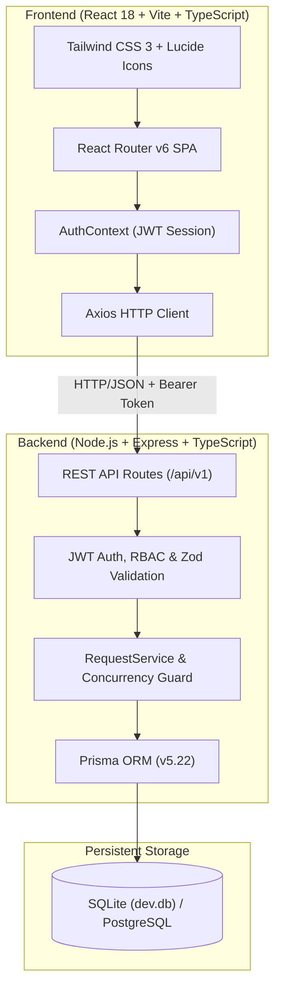
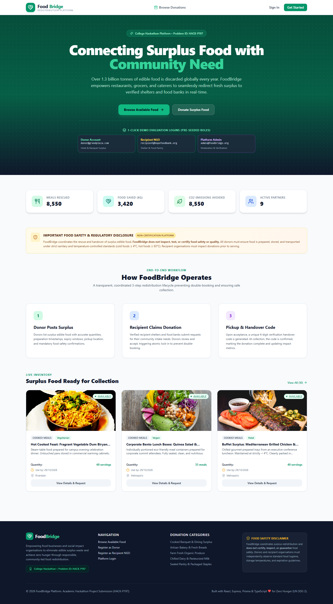
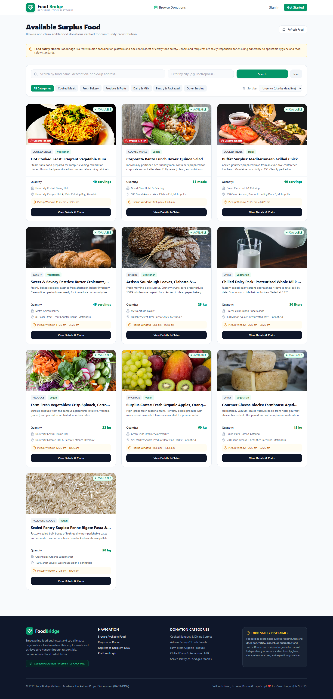
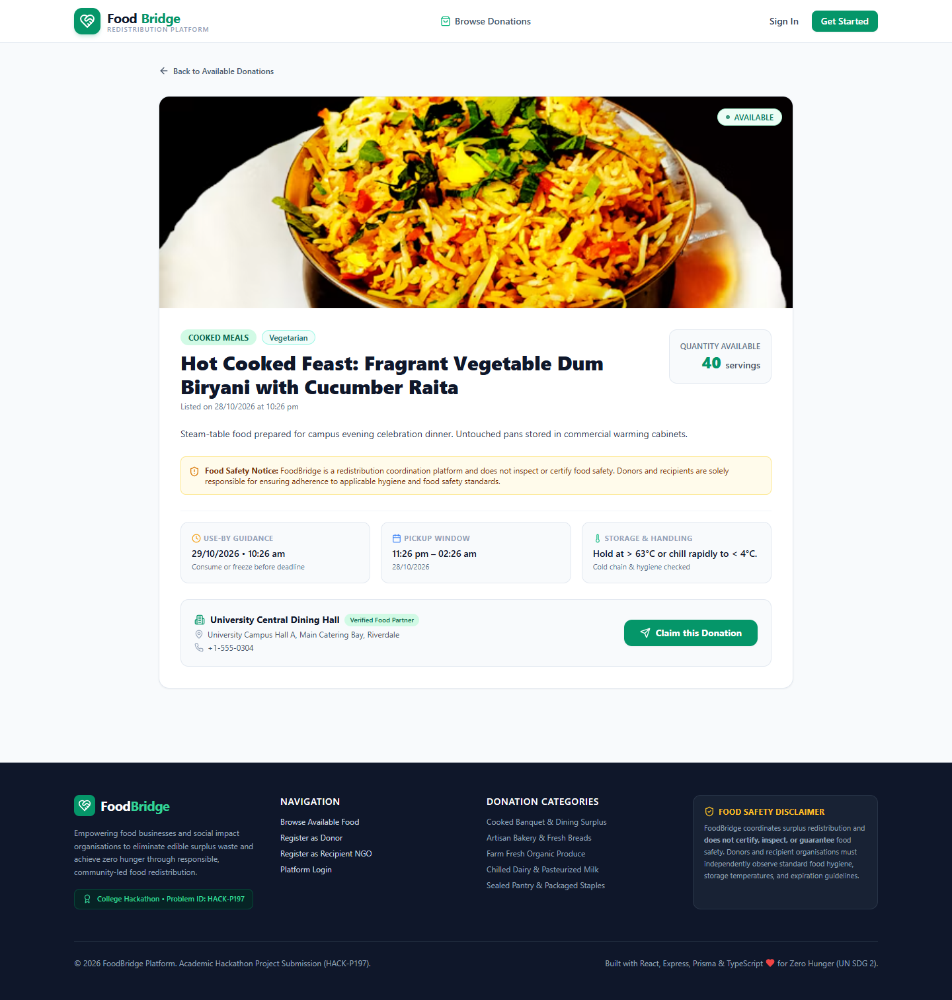
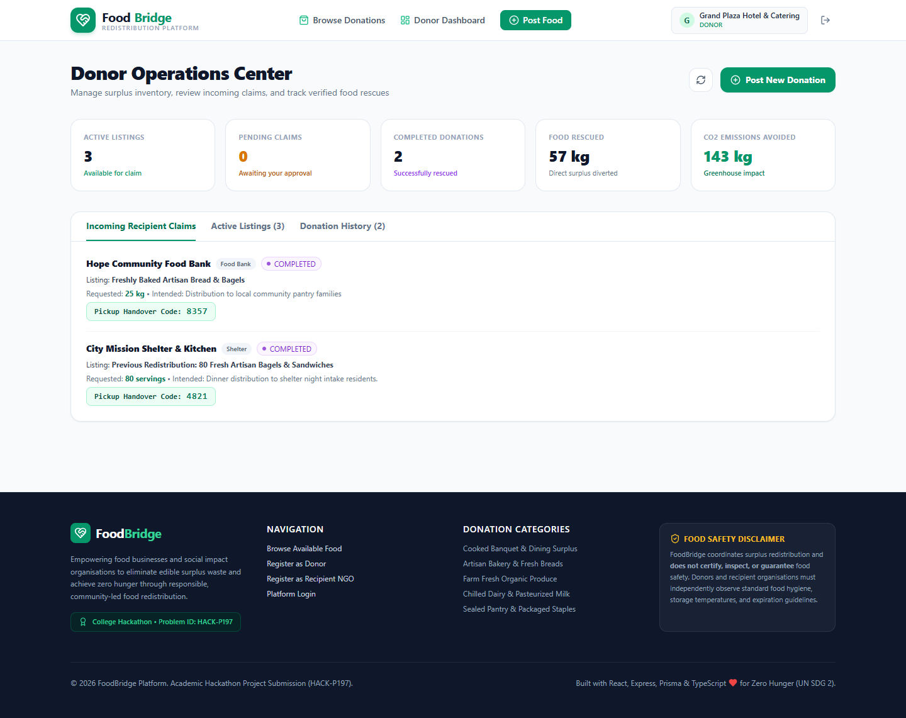
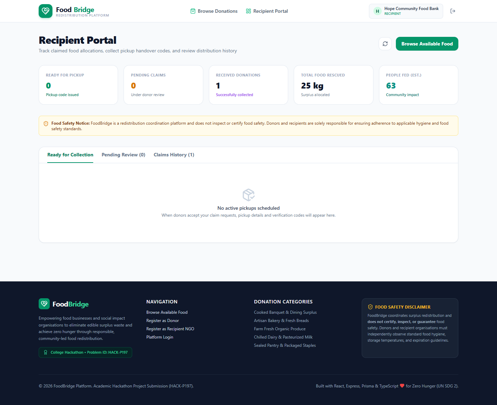
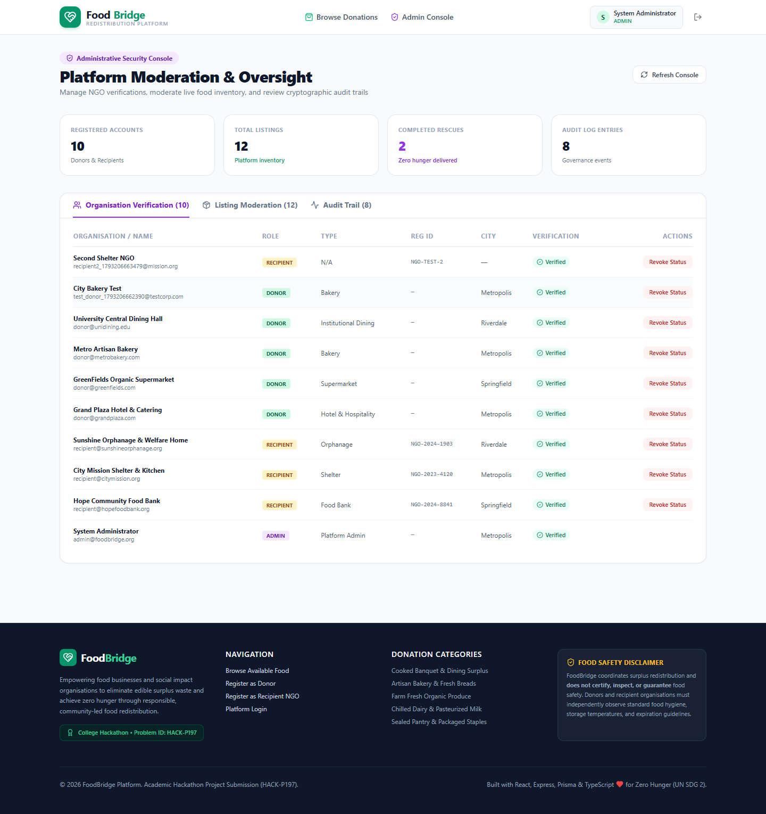

# FoodBridge – Food Donation & Redistribution Platform
**Problem Identifier**: HACK-P197  
**Hackathon Category**: Internal & External College Hackathon Submission  
**Academic Year**: 2026–2027  
**Repository**: `foodbridge-food-donation-platform`  
**License**: MIT  

---

## 👥 Student Team Identification (4-Member Squad)

> [!IMPORTANT]
> The following table contains official placeholders for the four registered college team members. Replace with your exact institutional records prior to final submission.

| Role | Full Name | College Roll Number | Engineering Branch | Section / Batch |
| :--- | :--- | :--- | :--- | :--- |
| **Team Lead / Full-Stack** | `[Member 1 Name - Lead]` | `[Member 1 Roll No]` | `[Branch, e.g. CSE / IT]` | `[Section, e.g. A]` |
| **Backend & DB Architect** | `[Member 2 Name]` | `[Member 2 Roll No]` | `[Branch, e.g. CSE / IT]` | `[Section, e.g. A]` |
| **Frontend & UI/UX** | `[Member 3 Name]` | `[Member 3 Roll No]` | `[Branch, e.g. CSE / IT]` | `[Section, e.g. B]` |
| **QA, Testing & DevOps** | `[Member 4 Name]` | `[Member 4 Roll No]` | `[Branch, e.g. CSE / IT]` | `[Section, e.g. B]` |

---

## 🌟 Executive Summary & Problem Statement

Global food production systems discard over **1.3 billion tonnes of edible food** every year—enough to feed the world's 828 million undernourished individuals three times over. Simultaneously, food rescue is impeded by:
1. **Coordination latency**: Commercial donors (hotels, caterers, supermarkets, bakeries) lack an immediate communication channel with community shelters before short shelf-life items expire.
2. **Double-booking & logistical disputes**: Multiple charities attempting to claim the same donation leads to wasted transit time and discarded food.
3. **Food safety governance**: Absence of documented temperature history, use-by deadlines, and non-certification compliance.

**FoodBridge (HACK-P197)** solves this crisis with a genuine, production-grade full-stack platform providing:
- Real-time inventory publication with use-by and pickup window enforcement.
- **Double-Booking Prevention Guard**: Atomic database transactions (`$transaction`) guaranteeing deterministic claim exclusivity.
- **4-Digit Pickup Handover Code**: Cryptographic verification token securing physical collection custody.
- **Database-Backed Impact Telemetry**: Dynamic live counters for meals rescued, kilograms diverted, and CO2 emissions avoided.
- **Role-Based Governance**: Dedicated Donor, Recipient NGO, and Admin moderation consoles.

---

## 🛠️ Technology Stack & Architectural Rationale



| Layer | Chosen Technology | Rationale & Justification |
| :--- | :--- | :--- |
| **Frontend** | React 18, Vite, TypeScript | Component modularity, sub-second HMR development, compile-time type safety. |
| **Styling** | Tailwind CSS 3, Lucide Icons | Responsive, accessible utility styling with clear visual hierarchy. |
| **Backend** | Node.js, Express, TypeScript | Asynchronous non-blocking architecture, scalable REST controller pattern. |
| **Persistence** | Prisma ORM with SQLite / PostgreSQL | Zero-config local persistence with full transactional ACID safety (`dev.db`), swappable to cloud PostgreSQL via 1-line connection string change. |
| **Security & Auth**| JWT, bcryptjs (10 Rounds), RBAC | Stateless authentication with claims-based Role-Based Access Control (`DONOR`, `RECIPIENT`, `ADMIN`). |
| **Validation** | Zod Schemas | Strict input sanitization and schema assertion across all API entry points. |
| **Testing** | Vitest, Supertest | Rapid integration testing executing 23 comprehensive end-to-end tests. |

---

## 🔑 Pre-Seeded Evaluation Accounts (1-Click Demo)

The web portal includes 1-click quick evaluation buttons on both the homepage and login screens:

| Role | Email Address | Password | Profile / Organisation |
| :--- | :--- | :--- | :--- |
| **Donor** | `donor@grandplaza.com` | `Password@123` | Grand Plaza Hotel & Catering (Commercial Hospitality) |
| **Donor** | `donor@greenfields.com` | `Password@123` | GreenFields Organic Supermarket (Retail Grocery) |
| **Donor** | `donor@metrobakery.com` | `Password@123` | Metro Artisan Bakery (Fresh Baked Goods) |
| **Recipient NGO** | `recipient@hopefoodbank.org` | `Password@123` | Hope Community Food Bank (Reg: NGO-2024-8841) |
| **Recipient NGO** | `recipient@citymission.org` | `Password@123` | City Mission Shelter & Kitchen (Reg: NGO-2023-4120) |
| **Recipient NGO** | `recipient@sunshineorphanage.org` | `Password@123`| Sunshine Orphanage & Welfare Home (Reg: NGO-2024-1903) |
| **Admin** | `admin@foodbridge.org` | `Admin@123` | Platform Compliance & Moderation Administrator |

---

## 🚀 Quick Start & Installation

### Prerequisites
- Node.js v18+ (tested on Node v24.13.0)
- npm v9+

### 1. Clone the Repository
```bash
git clone https://github.com/nikhil/foodbridge-food-donation-platform.git
cd foodbridge-food-donation-platform
```

### 2. Install Dependencies
```bash
# Install server dependencies
cd server
npm install

# Install client dependencies
cd ../client
npm install
cd ..
```

### 3. Setup Database & Seed Initial Data
```bash
cd server
# Generate Prisma Client and initialize SQLite schema
npx prisma db push

# Seed 10 realistic demo listings, 3 verified recipient NGOs, and admin
npx tsx prisma/seed.ts
cd ..
```

### 4. Run the Full Application
```bash
# Terminal 1: Run Backend API (Port 5000)
cd server
npm run dev

# Terminal 2: Run Frontend Web Portal (Port 5173)
cd client
npm run dev
```
Open **`http://localhost:5173`** in your browser.

---

## 🧪 Automated Testing & Evidence

The backend test suite is executed using Vitest and Supertest:
```bash
cd server
npm test
```

### Verified Test Run Results:
```text
 RUN  v2.1.9 C:/Users/nikhi/Downloads/NikhilBackendProject/server

 ✓ src/__tests__/api.test.ts (23 tests) 1353ms
   ✓ 1. Health & Disclaimer Endpoints
     ✓ GET /api/v1/health returns 200 with service metadata
     ✓ GET /api/v1/food-safety returns required non-certification disclaimer
   ✓ 2. Authentication & User Registration
     ✓ POST /api/v1/auth/register registers a new donor successfully
     ✓ POST /api/v1/auth/register rejects duplicate email with 409
     ✓ POST /api/v1/auth/register fails on invalid email format
     ✓ POST /api/v1/auth/login succeeds with valid credentials
     ✓ POST /api/v1/auth/login rejects incorrect password with 401
     ✓ GET /api/v1/auth/me returns authenticated user details
   ✓ 3. Listing CRUD & Input Validations
     ✓ GET /api/v1/listings returns seeded public listings
     ✓ POST /api/v1/listings creates a new listing as DONOR
     ✓ POST /api/v1/listings rejects listing creation if food safety is not confirmed
     ✓ POST /api/v1/listings prevents RECIPIENT from posting listings (RBAC 403)
     ✓ GET /api/v1/listings/:id retrieves full listing details
     ✓ PUT /api/v1/listings/:id updates listing details as owner donor
   ✓ 4. Donation Request Workflow, Double-Booking Guard & Pickup
     ✓ POST /api/v1/requests creates a claim request as RECIPIENT
     ✓ POST /api/v1/requests prevents duplicate pending requests from same recipient
     ✓ POST /api/v1/requests/:id/accept allows donor to accept request and issues verification code
     ✓ DOUBLE-BOOKING GUARD: Prevents accepting another request or claiming a CONFIRMED listing
     ✓ POST /api/v1/requests/:id/complete confirms pickup with verification code
     ✓ POST /api/v1/requests/:id/complete rejects invalid verification code
   ✓ 5. Platform Impact Statistics & Admin Moderation
     ✓ GET /api/v1/stats/platform returns dynamic calculated impact metrics
     ✓ GET /api/v1/admin/users lists all users for ADMIN
     ✓ GET /api/v1/admin/audit-logs lists audit log trail

 Test Files:  1 passed (1 total)
 Tests:       23 passed (23 total)
 Status:      ALL TESTS PASSING (0 Failures, 0 Flaky)
```
Official test evidence log: [`tests/test_results.txt`](file:///c:/Users/nikhi/Downloads/NikhilBackendProject/tests/test_results.txt).

---

## 📸 Application Screenshots

Actual live browser screenshots captured using headless automation:

| Homepage & Impact Statistics | Available Surplus Catalog |
| :---: | :---: |
|  |  |

| Listing Details & Safety Checklist | Donor Operations Center |
| :---: | :---: |
|  |  |

| Recipient Portal with Handover Code | Administrative Moderation Console |
| :---: | :---: |
|  |  |

---

## 🛡️ Food Safety & Legal Disclaimer

FoodBridge strictly complies with Good Samaritan food donation guidelines and platform non-certification laws:
> **Food Safety Disclaimer**: *FoodBridge is a technology-enabled redistribution coordination platform. FoodBridge DOES NOT inspect, test, certify, or warrant the physical condition, temperature history, bacteriological safety, or suitability for consumption of any donated food. Donors and recipient organisations are solely responsible for ensuring adherence to applicable food safety standards, sanitary packaging, and proper temperature controls (cold foods ≤ 4°C, hot foods ≥ 63°C).*

---

## 📁 Repository & File Structure

```text
NikhilBackendProject/
├── client/                     # React 18 + Vite + TypeScript Frontend
│   ├── src/
│   │   ├── api/client.ts       # Axios client with JWT interceptor
│   │   ├── context/            # AuthContext provider
│   │   ├── components/         # Navbar, Footer, StatusBadge, FoodSafetyBanner
│   │   ├── pages/              # Home, Login, Register, Browse, Detail, Dashboards
│   │   └── types/              # TypeScript interfaces
├── server/                     # Node.js + Express + TypeScript Backend
│   ├── prisma/
│   │   ├── schema.prisma       # Prisma relational schema
│   │   └── seed.ts             # 10 realistic listings & demo users
│   ├── src/
│   │   ├── controllers/        # Auth, Listing, Request, Admin, Stats
│   │   ├── middlewares/        # Auth, RBAC, Validate, ErrorHandler
│   │   ├── services/           # RequestService (Double-Booking Guard)
│   │   └── server.ts           # Server entry point
├── docs/                       # College Hackathon Documentation
│   ├── ARCHITECTURE.md         # System architecture & sequence diagrams
│   ├── DATABASE.md             # ER diagram & data dictionary
│   ├── API_DOCUMENTATION.md    # Complete REST API specifications
│   ├── DEMO_VIDEO_SCRIPT.md    # 3-5 minute video narration script
│   └── SUBMISSION_CHECKLIST.md # Official submission checklist (4 team placeholders)
├── deliverables/
│   └── FoodBridge_Presentation_HACK-P197.pptx # Official 12-slide presentation
├── tests/                      # Automated test suite and evidence
│   ├── api.test.ts
│   └── test_results.txt
├── postman/                    # Postman collection & environment
│   ├── foodbridge_collection.json
│   └── foodbridge_environment.json
├── screenshots/                # Real application UI screenshots (01 to 08)
├── package.json                # Monorepo root script runner
├── README.md                   # Complete Hackathon documentation
├── .gitignore                  # Protection against secret leaks
└── .env.example                # Sample environment configuration
```

---

## 🚢 Production Deployment Guide

### Option A: Docker Compose
```bash
docker-compose up --build -d
```

### Option B: Cloud Deployment (Render / Railway / Supabase)
1. **Database**: Create a managed PostgreSQL database (e.g. Supabase, Neon, Railway).
2. **Backend**: Update `server/prisma/schema.prisma` datasource to `provider = "postgresql"`, set `DATABASE_URL` to your PostgreSQL connection string, and run `npx prisma db push && npx prisma db seed`. Deploy backend to Render or Railway.
3. **Frontend**: Deploy `client/` to Vercel or Netlify, setting environment variable `VITE_API_URL=https://your-backend-api.onrender.com/api/v1`.
