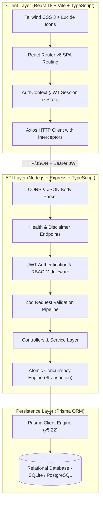
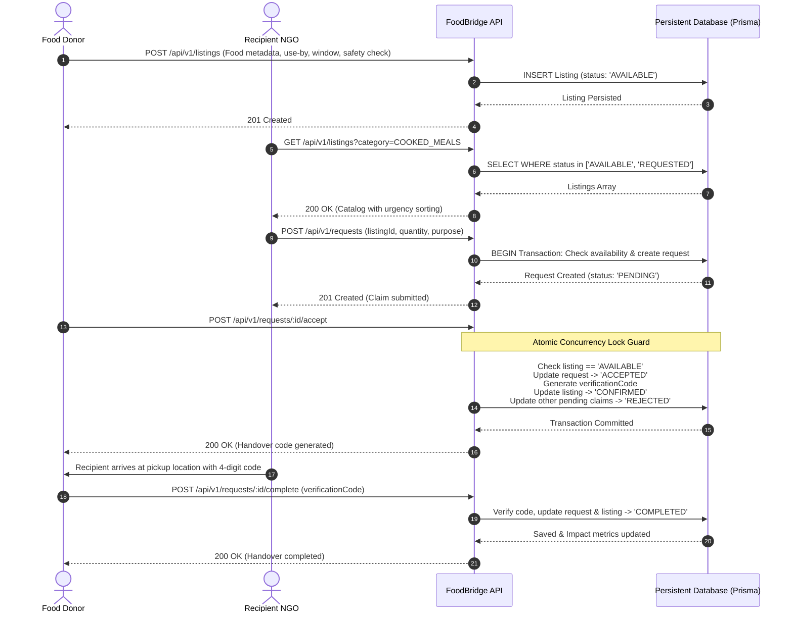

# FoodBridge System Architecture & Technical Design
**Problem ID**: HACK-P197  
**Project**: FoodBridge – Food Donation and Redistribution Platform  

---

## 1. System Overview

FoodBridge is a genuine full-stack, three-tiered food redistribution platform architected to eliminate edible commercial surplus food waste by bridging verified donors (restaurants, hotels, bakeries, grocers, institutional caterers) with community social impact organisations (shelters, food banks, community kitchens, orphanages).

---

## 2. Technology Stack & Rationale

| Layer | Selected Technology | Technical Rationale |
| :--- | :--- | :--- |
| **Frontend** | React 18, Vite, TypeScript | Fast component re-renders, strict type safety, sub-second HMR development, modern responsive UX. |
| **Styling** | Tailwind CSS 3, Lucide Icons | Utility-first responsive design, accessible UI patterns, clean visual hierarchy. |
| **Backend API** | Node.js, Express, TypeScript | Asynchronous non-blocking I/O, enterprise-grade REST architecture, modular routing and controllers. |
| **Data Persistence**| Prisma ORM (SQLite / PostgreSQL) | Zero-configuration local disk persistence (`dev.db`), ACID transactions, fully swappable to PostgreSQL via 1-line connection string change. |
| **Security & Auth** | JSON Web Tokens (JWT), bcryptjs | Stateless authorization, salted password hashing (cost factor 10), Role-Based Access Control (`DONOR`, `RECIPIENT`, `ADMIN`). |
| **Validation** | Zod Schemas | Strong schema-level input validation preventing malformed payloads, injection, and invalid dates. |
| **Testing** | Vitest, Supertest | Ultra-fast in-memory test runner executing 23 comprehensive integration tests across all workflows. |

---

## 3. End-to-End Redistribution Sequence

The complete donor-to-recipient redistribution lifecycle enforces double-booking prevention, audit logging, and secure pickup verification.

---

## 4. Double-Booking Prevention & Concurrency Guard

To prevent multiple recipient organisations from claiming the same perishable food donation simultaneously:
1. **Prisma Interactive Transaction (`prisma.$transaction`)**: All claim acceptance operations are wrapped in an atomic transaction block.
2. **State Guard**: The engine inspects `listing.status`. If the listing is already `CONFIRMED` or `COMPLETED`, the transaction aborts and returns an `HTTP 409 Conflict`.
3. **Automatic Conflict Rejection**: Once a donor accepts a specific recipient's claim, all other pending requests for that listing are automatically updated to `REJECTED` with the audit note: *"Listing fulfilled by another recipient organization"*.
4. **Cancellation Reversion**: If an accepted recipient cancels their request prior to collection, the transaction cleanly reverts the listing status back to `AVAILABLE`.

---

## 5. Security & Food Safety Governance

### Role-Based Access Control (RBAC)
- **DONOR**: Can create, edit, and cancel their own food listings; review incoming claim requests; accept/reject claims; verify handover codes.
- **RECIPIENT**: Can search/filter listings; submit claim requests; view assigned handover codes; cancel own requests; confirm pickup.
- **ADMIN**: Can verify/unverify recipient NGOs; moderate and remove inappropriate listings; inspect all system audit logs.

### Mandatory Food Safety Disclaimer
FoodBridge operates under strict compliance with non-certification platform regulations:
> *"FoodBridge is an administrative redistribution coordination platform and does not certify, inspect, or warrant food safety or quality. Donors and recipients are solely responsible for ensuring adherence to applicable hygiene, temperature thresholds (cold ≤ 4°C, hot ≥ 63°C), and food safety laws."*
