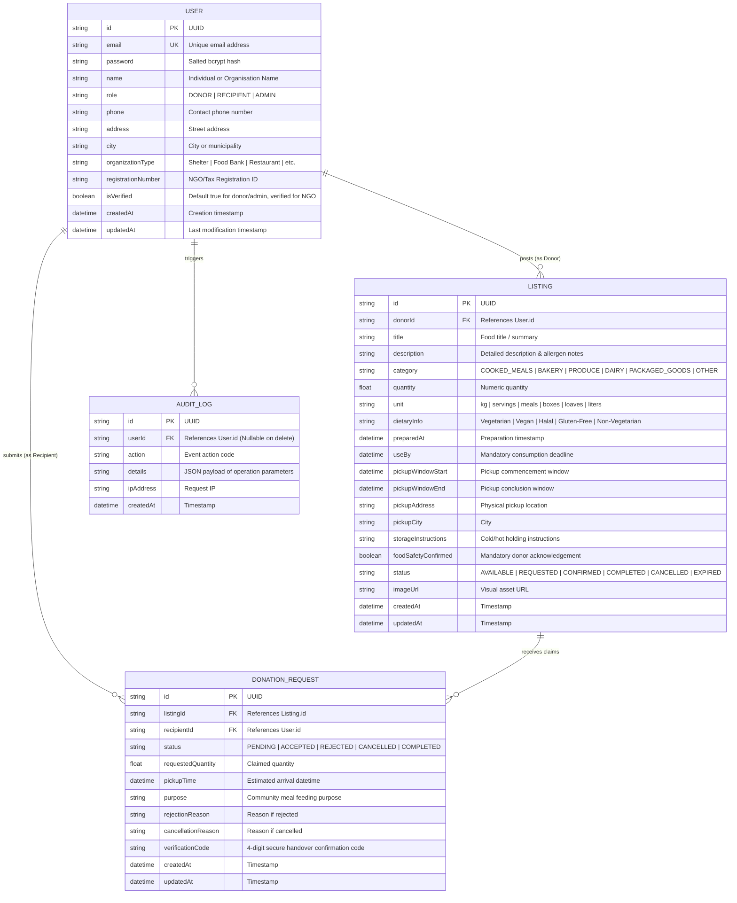

# FoodBridge Database Schema & Entity-Relationship Design
**Problem ID**: HACK-P197  
**Platform**: FoodBridge – Food Donation and Redistribution Platform  

---

## 1. Entity-Relationship (ER) Diagram

---

## 2. Table Specifications & Data Dictionary

### Table: `User`
Stores authenticated platform actors including donors, recipient NGOs, and administrators.
- `id` (String, Primary Key, UUID)
- `email` (String, Unique Index)
- `password` (String, bcrypt salted hash, 10 rounds)
- `name` (String, required)
- `role` (String, default: "DONOR", valid values: "DONOR", "RECIPIENT", "ADMIN")
- `isVerified` (Boolean, default: false for recipients without registration number)

### Table: `Listing`
Stores surplus food listings published by authenticated donors.
- `id` (String, Primary Key, UUID)
- `donorId` (String, Foreign Key -> `User.id`, Cascade on delete)
- `title` (String, required, min length 3)
- `category` (String, values: `COOKED_MEALS`, `BAKERY`, `PRODUCE`, `DAIRY`, `PACKAGED_GOODS`, `OTHER`)
- `quantity` (Float, strictly positive)
- `unit` (String, e.g. "kg", "servings", "meals", "boxes")
- `useBy` (DateTime, required consumption deadline)
- `pickupWindowStart` / `pickupWindowEnd` (DateTime, start must precede end)
- `foodSafetyConfirmed` (Boolean, required true to publish)
- `status` (String, values: `AVAILABLE`, `REQUESTED`, `CONFIRMED`, `COMPLETED`, `CANCELLED`, `EXPIRED`)

### Table: `DonationRequest`
Coordinates claims between recipient organisations and available food donations.
- `id` (String, Primary Key, UUID)
- `listingId` (String, Foreign Key -> `Listing.id`, Cascade on delete)
- `recipientId` (String, Foreign Key -> `User.id`, Cascade on delete)
- `status` (String, values: `PENDING`, `ACCEPTED`, `REJECTED`, `CANCELLED`, `COMPLETED`)
- `verificationCode` (String, 4-digit code generated upon donor acceptance)

### Table: `AuditLog`
Immutable operational log tracking security events, listing moderation, and status transitions.
- `id` (String, Primary Key, UUID)
- `userId` (String, Nullable Foreign Key -> `User.id`)
- `action` (String, e.g. `LISTING_CREATED`, `REQUEST_ACCEPTED`, `PICKUP_COMPLETED`)
- `details` (String, serialized JSON)
- `createdAt` (DateTime, default: now)
